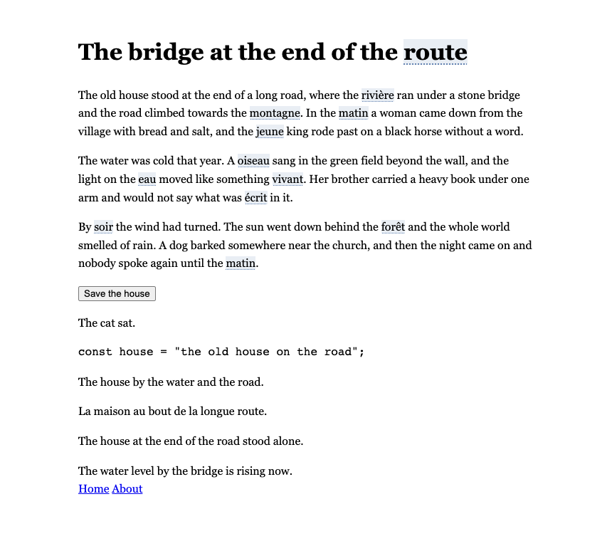
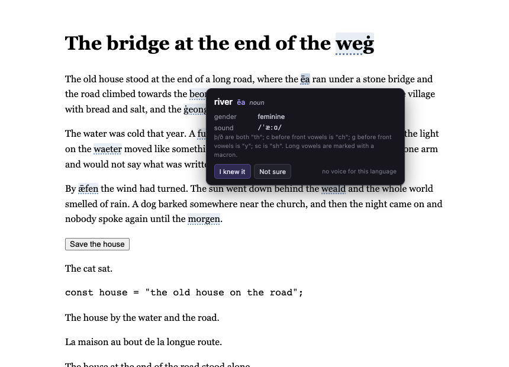
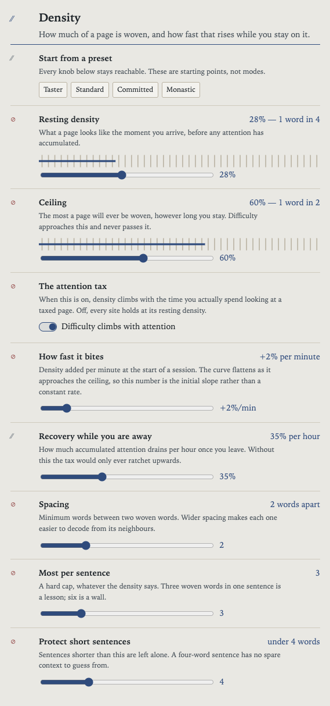
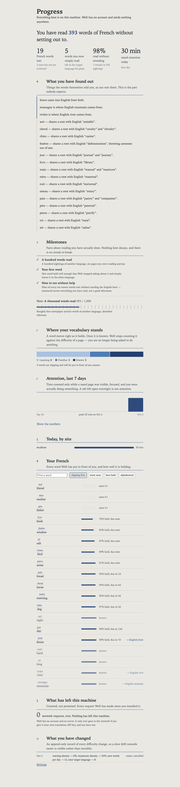
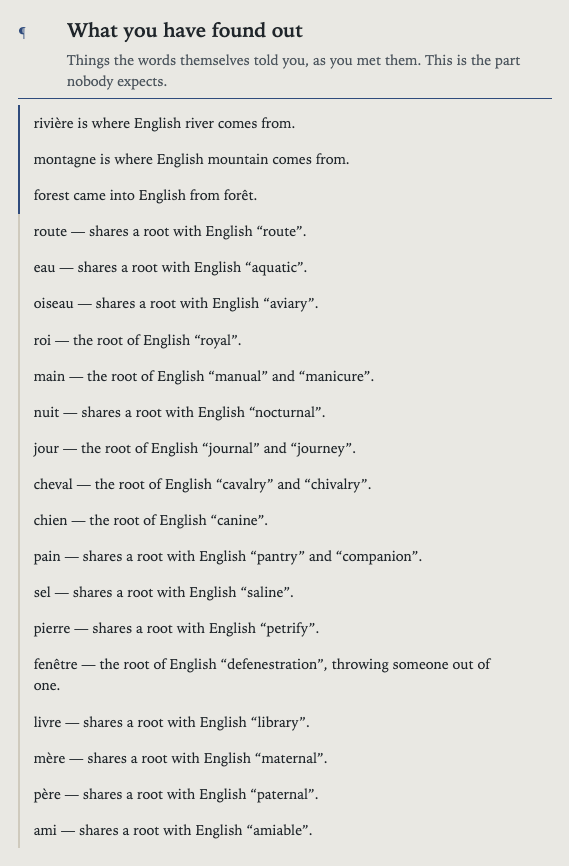

# Weft

**Some of the words on the pages you read are in another language. The longer
you stay on a page, the more of them there are.**

Weft is a browser extension that weaves a proportion of the words on a page
into a language you are learning, and raises that proportion with the time you
actually spend looking at the page. Five minutes on a news article costs you
almost nothing. Forty minutes on an infinite feed and you are reading a third
in French, and more than half of it if you raise the ceiling.

Point at a word and it gives you the English back.



> The old house stood at the end of a long **route**, where the **rivière** ran
> under a stone bridge and the road climbed towards the mountain. In the
> **matin** a woman came down from the village with bread and salt, and the
> **jeune** king rode past on a black **cheval** without a word.

---

## Why this works

This is not a new idea. It is the **diglot weave**, developed by Robert Blair
at BYU in the 1970s: keep a text 95–98% comprehensible and weave the new
language in just above the reader's threshold, so meaning arrives from context
rather than from a dictionary. Replications have found it as effective as
drilling for vocabulary acquisition and considerably more pleasant, and an
IES-funded tool called LoomVue has since applied the same method with adaptive
difficulty. Weft's contribution is not the method — it is tying the difficulty
to *attention*, so that the time you were going to lose anyway is the thing
that buys the vocabulary.

Three things follow from taking the method seriously, and they are where most
of the engineering went:

**Function words are never woven.** Replacing "the", "of" and "and" destroys
the grammatical scaffolding you are using to decode everything else, for
almost no vocabulary gained. Content words — concrete nouns first, then
adjectives — are where comprehensible input lives.

**Difficulty only ever goes up mid-page.** A word you have just decoded must
not flip back to English as the page gets harder around it. Selection is
therefore pinned: whatever is on screen stays on screen, and rising difficulty
only appends.

**Words you know stop costing you.** Once a word is genuinely learned it is
left in the target language permanently and no longer counts against the
page's difficulty budget. It is not a demand on you any more; it is the part
of the page you can already read.

See [docs/PEDAGOGY.md](docs/PEDAGOGY.md) for the rest, including why verbs are
woven as infinitives and why Latin drops in as a nominative.

---

## The English word you already know

Weft does not just show you a foreign word. It tells you which English word
it is related to, which is usually the thing that makes it stick.

A very large part of English arrived from French, and most of the rest shares
a Latin root with it — so the French word on your page is often already
inside an English word you use:

| French | | English | related to |
|---|---|---|---|
| `cheval` | → | horse | shares a root with *cavalry* and *chivalry* |
| `fenêtre` | → | window | shares a root with *defenestration* |
| `jour` | → | day | shares a root with *journal* and *journey* |
| `main` | → | hand | shares a root with *manual* and *manicure* |
| `rivière` | → | river | English took the word itself |

Two different claims, kept apart deliberately. English **took** `rivière`
itself; it never took `cheval`, which shares a root with a word that means
something else. Stating the second as though it were the first would be a
nice story and a false one, and the discoveries feed would then repeat it as
fact. `tools/seed/fr-cousins.tsv` holds both, labelled.

## Historical languages

The same device, taken as far as it goes — a narrower interest than French,
and there for the people who have it.



In Old English the word Weft puts on the page is usually the **literal
ancestor** of the word it replaced — `hūs` for house, `stān` for stone,
`cyning` for king — and the tooltip tells you so. You are not memorising a
foreign word; you are being shown where your own word came from. In Latin it
is the word your English borrowed from: `vacca` gave us *vaccine*, `mīlle
passūs` gave us *mile*, `paene īnsula` gave us *peninsula*.

The false friends are marked, because they are the most memorable thing in the
language. Old English `drēam` means joy and music, not a sleeping vision.
`steorfan` means simply to die, and became *starve*. `sellan` means to give.

Neither language has a speech-synthesis voice on any platform, so the tooltip
shows a reconstructed pronunciation in IPA instead of pretending to offer
audio. Roughly 700 transcriptions are derived from the orthography, which is
near-deterministic in both once vowel length is marked. The generator checks
itself against forms worked out by hand, and the test suite holds every Latin
transcription to the classical rules of syllable and stress, and every Old
English one to its grammar's rules of stress and voicing.

A letterform switch separates orthographic difficulty from vocabulary
difficulty. `þēod` is not hard because of the word, it is hard because of the
thorn and the macron — so beginners can read `theod` and graduate later.
Collapsing those two axes is why most historical-language tools feel
impossible on day one.

---

## What is in the box

| | |
|---|---|
| **Languages** | French, Spanish, German, Italian, Portuguese, Latin, Old English |
| **Lexicon** | 356 checked English lemmas per language, 581–588 entries across 576–583 surface forms, 653 KB for all seven |
| **Network** | None. No account, no telemetry, no server. Works offline. |
| **Optional** | Bring-your-own-key DeepL, Google or any OpenAI-compatible endpoint, for words beyond the packs |
| **Install warning** | None of the scary ones — Weft asks for no site access until you name the sites |

Languages the registry knows but has no lexicon for yet — Dutch, Swedish,
Welsh, Irish, Middle English, Old Norse, Ancient Greek, Gothic — are shown
disabled and labelled, rather than silently doing nothing. Building a pack for
one is `npm run packs`; see [tools/seed/README.md](tools/seed/README.md).

---

## The screen-time half

Anything that makes Weft **easier** waits.



Lower the density, shorten the ceiling, take a site off the list, drop your
level — each of those is queued behind a cooldown you set in advance. The
clock is stored rather than scheduled: closing the browser neither cancels it
nor restarts it, and re-requesting the same change does not move it. Anything
that makes Weft *harder* applies at once.

Optionally the cooldown is also gated on a short vocabulary check, drawn only
from words Weft has already shown you. The exit tax is itself the lesson, and
the answers count as retrieval practice whether or not you pass.

**Cancelling a queued change is always instant and free.** Friction on the way
*out* of a commitment would be coercion; friction on the way *into* an easier
setting is a commitment.

**There is a panic pass.** Plain English for a few minutes, a fixed number of
times a day, logged. This exists because a tool with no escape hatch gets
uninstalled the first time someone genuinely needs to read something, and an
uninstalled tool teaches nothing.

**And there is Hard Mode**, for people who want the extension itself to be
unremovable. Weft generates a browser managed-policy profile that marks it
`force_installed`, which is the only mechanism that actually stops you from
clicking Remove. You install it yourself with your own administrator password,
and the removal instructions ship inside the same file. See
[docs/HARD-MODE.md](docs/HARD-MODE.md).

---

## Progress



Weft schedules with **FSRS-6**, the same memory model Anki uses, ported
directly from the reference implementation. That is not decoration: "which
words should be in the target language right now?" is exactly the question a
spaced-repetition scheduler answers. A word whose retrievability has decayed
to around 0.7 is the word that most benefits from being seen again, and a word
whose stability has passed the retirement threshold can be left in L2 for
good. The page becomes the review session.

The honest measure of whether it is working is not time on site or words seen.
It is words that graduated.

---

## What it costs

**Free, for one language, forever** — any of the seven, including Latin and
Old English. The whole lexicon for it, the whole escalation curve, the whole
tooltip, your vocabulary and progress, and export. Not a trial.

**Pro** adds every language at once, a different language per site, Hard Mode,
your own translation key for unlimited vocabulary, phrases, the full history
and custom word lists. $3.50 a month, $24 a year, or $59 once.

Some things are never gated at any price: accessibility, the never-weave list,
panic passes, and exporting your own data. There is a test that fails if
anyone moves one of them behind the paywall.

Your licence is a **signed file verified on your own machine** against a key
compiled into the extension. No account, no activation server, and no request
— not at purchase, not at launch, not ever. The honest cost is that a licence
cannot be revoked; [docs/PRICING.md](docs/PRICING.md) says so rather than
pretending otherwise.

---

## Three things that make it trustworthy rather than magic

**It tells you why.** Hover a woven word and, next to the translation, it says
why that word was chosen — *"Chosen because it is due for review, and it is
recognisably related to the English word."* The selector already computed a
factor breakdown; rendering it as a sentence rather than a table of decimals
is the difference between a debugging panel and an explanation.

**It counts what leaves.** The progress page shows how many network requests
Weft has made since you installed it. For anyone who has not configured a
translation key that number is zero and stays zero, which is a better argument
than a paragraph promising the same thing.

**It shows you what you found out.** The lexicon knows that `hlāford` means
loaf-keeper, that `steorfan` meant simply to die, that `cwēn` originally just
meant woman. Those are the most charming facts in the product and nothing
surfaced them. Now there is a feed, built only from words you have actually
met, with the meaning-shifts first — because a list where two lines in three
read "English X comes straight from Y" stops being read.



---

## Install

Not in the stores yet — [docs/SUBMIT.md](docs/SUBMIT.md) is the runbook for
getting it there, and [the install page](https://weft.study/install) walks a
reader through loading it by hand. From source:

```sh
git clone https://github.com/quiquae/weft
cd weft
npm install
npm run packs      # build the lexicons from the seed files
npm run build:all  # -> dist/chrome, dist/firefox, dist/safari
```

| Browser | How |
|---|---|
| **Chrome / Edge / Brave** | `chrome://extensions` → Developer mode → **Load unpacked** → `dist/chrome` |
| **Firefox** | `about:debugging` → This Firefox → **Load Temporary Add-on** → `dist/firefox/manifest.json` |
| **Safari** | `npm run safari`, then build the generated Xcode project. Needs the full Xcode; the script explains what to install. |

Edge takes the Chrome package unchanged — there is no separate Edge build
because there is no difference.

Safari needs more than a zip: the extension has to be wrapped in a native app
and signed. `npm run safari` does the conversion and prints the remaining
Xcode steps. Three APIs behave differently there — no notifications, no
keyboard shortcuts below Safari 26, and no CSS Custom Highlight API below
17.2 — all handled with fallbacks, all listed in
[docs/SUBMIT.md](docs/SUBMIT.md).

Weft will open its first-run page and ask you three questions. It has access
to no website until you answer the third one.

---

## Development

```sh
npm run dev            # watch build
npm run typecheck      # tsc --noEmit
npm test               # 566 unit + 102 jsdom + 361 over the build tools
npm run test:e2e       # 40 tests in a real Chromium with the extension loaded
npm run compat         # every API we use, checked against MDN's compat data
npm run validate       # pre-flight the built packages against store rules
npm run test:all       # everything, in the order that fails fastest
npm run packs:verify   # sanity-check the lexicons
npm run artefacts:check # which committed generated files the tree has moved past
npm run build:all      # chrome + firefox + safari
npm run zip            # per target: a flat archive for the store, a -folder one for humans
npm run safari         # wrap the Safari build in an Xcode project
npm run site           # generate the 714-page content site from the lexicon
npm run icons          # draw the toolbar icons and the vector mark
npm run tiles          # render the store promo tiles
npm run og             # render the social card
npm run release -- --version=X.Y.Z           # version, build, package, notes
npm run licence -- --name="..." --tier=pro   # issue a licence key
```

`npm run test:e2e` reports "39 passed, 3 skipped". The three skipped ones
are asset generators rather than assertions — `WEFT_STORE=1`,
`WEFT_SCREENS=1` and `WEFT_FIRSTRUN=1` turn them on when the store
screenshots need redrawing.

`src/core/` is pure: no DOM, no `chrome.*`, no I/O. Every interesting decision
— which word to swap, how hard the page should get, whether a settings change
is allowed yet — lives there and is unit-tested without a browser. That
boundary is the reason the test suite is fast and the reason five real bugs
were caught before anyone ran the extension.

See [docs/ARCHITECTURE.md](docs/ARCHITECTURE.md), which explains the one
decision everything else follows from: why Weft edits `nodeValue` in place
instead of replacing text nodes, and why that is what keeps it from crashing
React applications the way Google Translate does.

Two more worth the time. [PEDAGOGY.md](docs/PEDAGOGY.md) cites the research
and then lists, under its own heading, which claims are judgement rather than
evidence. [LAUNCH.md](docs/LAUNCH.md) is the link-building kit, with drafts
per community — written to be sent by a human, because an automated account
posting self-promotion gets the domain shadowbanned and would undo the search
work.

---

## Privacy

Everything is on your machine. There is no account, no server, and no
telemetry — the setting for telemetry does not exist rather than defaulting to
off, and validation refuses to turn it on.

Weft ships a never-weave list covering money, mail, credentials and health,
checked before anything else and before any lexicon is even loaded. A language
tool has no business between you and your bank.

If you enable a translation service, it receives **isolated words and a
part-of-speech hint, never page text**. There is no parameter in that
interface to put a paragraph in. Sending one sentence of surrounding context
improves accuracy and is a separate, explicit opt-in.

Full detail, including what the integrity signing does and does not protect
against, is in [docs/PRIVACY.md](docs/PRIVACY.md).

---

## Licence

Code is **MIT**. The lexicons are **CC BY-SA 4.0**, because they derive from
Wiktionary-adjacent and SUBTLEX-derived sources that carry share-alike terms;
Latin and Old English glosses are checked against public-domain dictionaries.
Attribution travels inside every generated pack. See
[docs/THIRD-PARTY.md](docs/THIRD-PARTY.md).

If you intend to sell this, MIT is probably not the licence you want — it
lets anyone ship a copy. That is a business decision rather than a technical
one, so it is left as a single file to change.
